<div align="center">


<br>

---

<br>

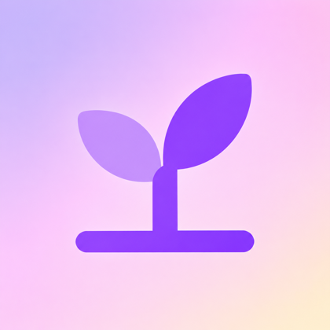

### *나의 작은 기록 마이로그*

*완벽하지 않아도 괜찮은, 나의 기록 My Log*

잠깐 멈춰, 오늘의 나를 만나보세요.<br>
한 줄씩만 적어도 충분해요.


</div>

하루 또는 기간 단위로 회고를 쓰고, 카테고리·태그로 찾아보고, 통계로 돌아볼 수 있는 iOS 회고 앱입니다. SwiftUI와 SwiftData로 만들었고, 모든 데이터는 기기 안에만 저장됩니다.

<table>
  <tr>
    <td align="center">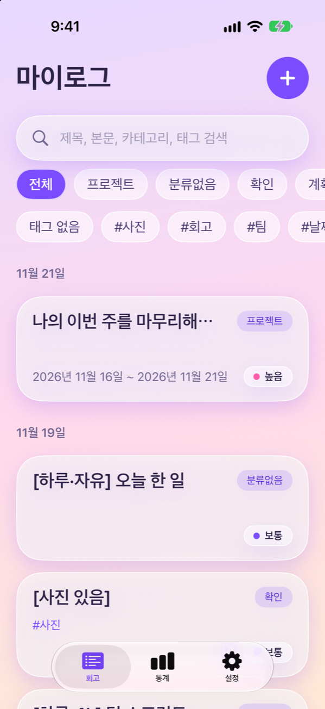<br>회고 목록</td>
    <td align="center">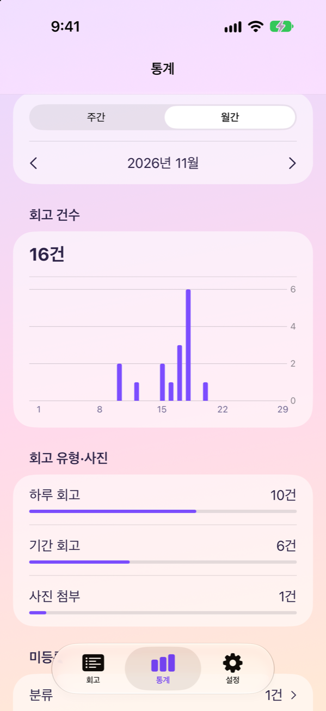<br>월간 통계</td>
    <td align="center">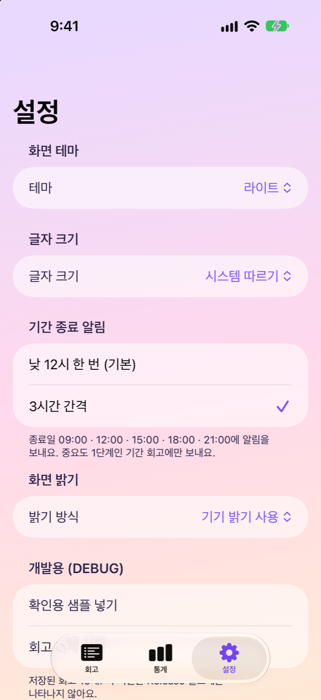<br>설정</td>
  </tr>
</table>

| 항목 | 내용 |
| --- | --- |
| 앱 표시 이름 | **마이로그** |
| Xcode 프로젝트 이름 | `Journal` |
| Bundle ID | `com.acb.Journal` |
| 버전 | 1.0 (`MARKETING_VERSION`) |
| 저장소 | [bum8844/Journal](https://github.com/bum8844/Journal) |

## 목차

- [주요 기능 한눈에 보기](#주요-기능-한눈에-보기)
- [화면별 기능 설명](#화면별-기능-설명)
  - [시작 화면](#시작-화면)
  - [회고 탭: 목록](#회고-탭-목록)
  - [회고 작성·편집](#회고-작성편집)
  - [회고 상세](#회고-상세)
  - [통계 탭](#통계-탭)
  - [설정 탭](#설정-탭)
- [동작 규칙 자세히 보기](#동작-규칙-자세히-보기)
- [실행 환경](#실행-환경)
- [설치 및 실행 방법](#설치-및-실행-방법)
- [의존 라이브러리](#의존-라이브러리)
- [폴더 구조](#폴더-구조)
- [데이터 모델](#데이터-모델)
- [개발 참고](#개발-참고)
- [자주 묻는 질문](#자주-묻는-질문)
- [참고 문서](#참고-문서)
- [개발팀](#개발팀)
## 주요 기능 한눈에 보기

| 기능 | 설명 |
| --- | --- |
| 세 가지 작성 형식 | 자유 · 오늘의 경험 · 내일을 위한 정리 |
| 하루 / 기간 회고 | 하루짜리 기록과 시작일~종료일이 있는 기간 기록을 모두 지원 |
| 사진 첨부 | 회고마다 사진 한 장. 저장할 때 크기를 줄이고 위치 정보를 지움 |
| 중요도 | 1(높음) · 2(보통) · 3(낮음). 1단계 기간 회고는 종료일에 알림 |
| 카테고리·태그 | 카테고리 한 개, 태그 여러 개. 검색과 필터로 바로 찾기 |
| AI 한마디 | 기기 안의 Apple Intelligence가 다음에 해 볼 행동을 제안 |
| 통계 | 주간·월간 회고 건수, 일정, 중요도, 태그, 카테고리 비율 |
| 화면 설정 | 라이트/다크 테마, 글자 크기, 화면 밝기 |
| 개인정보 보호 | 서버 전송 없음. 회고, 사진, AI 생성 모두 기기 안에서 처리 |

## 화면별 기능 설명

앱은 하단 탭 세 개(**회고 · 통계 · 설정**)로 구성됩니다.

### 시작 화면

앱을 켜면 새싹 이미지가 있는 커버 화면이 약 1초 보인 뒤 사라집니다. 배경은 현재 테마(라이트/다크)를 따릅니다.

<table>
  <tr>
    <td align="center">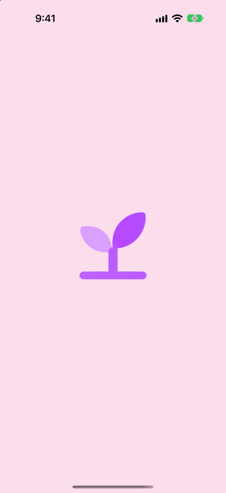<br>시작 커버</td>
  </tr>
</table>

### 회고 탭: 목록

- **날짜별 묶음**: 작성일 기준 최신순으로 정렬하고, 같은 날 쓴 글을 한 묶음으로 보여 줍니다. 묶음 제목은 `오늘`, `어제`, `11월 17일`(올해), `2025년 11월 17일`(지난해 이전) 형식입니다.
- **카드 구성**: 제목, 카테고리, 태그(`#태그`), 날짜, 사진 아이콘(사진이 있을 때), 중요도 배지가 표시됩니다.
- **검색**: 제목, 내용, 카테고리, 태그에서 키워드를 찾습니다. 대소문자는 구분하지 않습니다.
- **필터**: 카테고리 하나와 태그 여러 개를 고를 수 있습니다. 태그를 여러 개 고르면 **선택한 태그를 모두 가진** 글만 남습니다. `태그 없음`만 모아 보기와 `필터 해제`도 지원합니다.
- **삭제**: 카드를 왼쪽으로 밀어 삭제합니다.
- **빈 화면**: 회고가 하나도 없으면 "아직 회고가 없어요 / 첫 회고를 남겨 보세요" 안내와 `회고 추가하기` 버튼이 나옵니다. 검색이나 필터 결과가 없을 때는 "기록을 찾을 수 없어요" 안내가 나옵니다.

<table>
  <tr>
    <td align="center"><br>목록 (라이트)</td>
    <td align="center">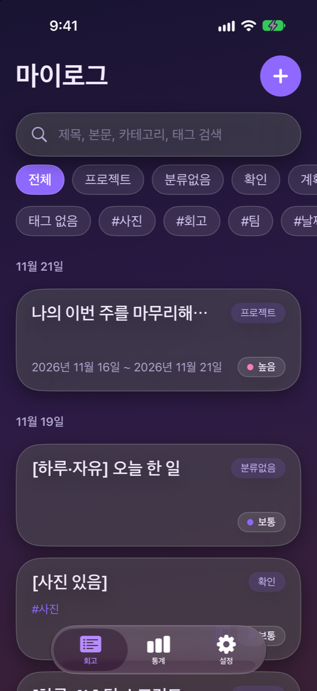<br>목록 (다크)</td>
    <td align="center">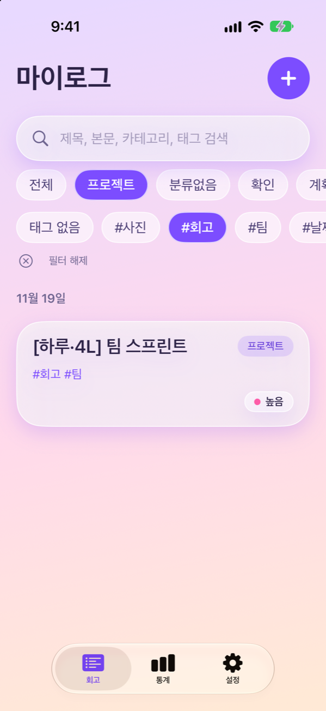<br>필터 적용</td>
    <td align="center">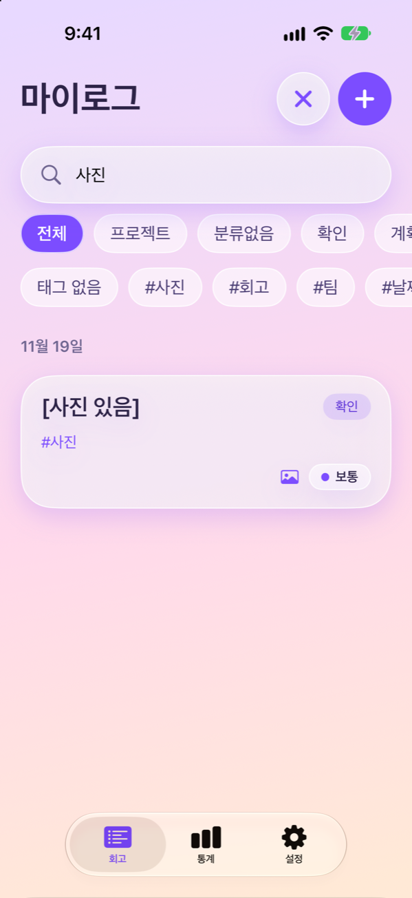<br>검색 결과</td>
  </tr>
  <tr>
    <td align="center">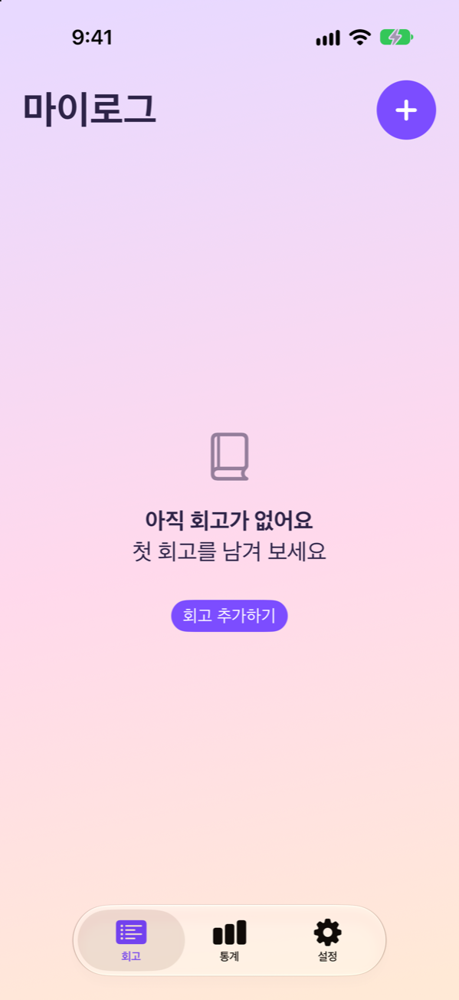<br>빈 화면 (첫 실행)</td>
    <td align="center">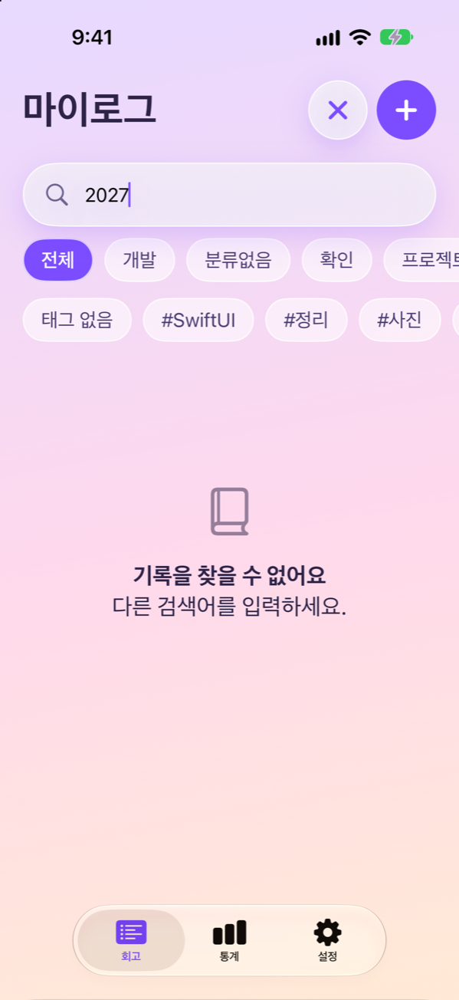<br>결과 없음</td>
  </tr>
</table>

### 회고 작성·편집

작성 화면은 위에서 아래로 다음 순서로 구성됩니다.

1. 형식 선택 탭
2. 제목
3. 본문 또는 질문 카드
4. AI 한마디
5. 날짜(하루/기간)
6. 중요도
7. 사진
8. 카테고리와 태그

**작성 형식**

| 형식 | 입력 방식 | 질문 |
| --- | --- | --- |
| 자유 | 본문 한 칸 | 없음 ("오늘 하루를 자유롭게 적어보세요") |
| 오늘의 경험 | 질문 카드 4개 | 좋았던 점 · 배운 점 · 아쉬웠던 점 · 바라는 점 |
| 내일을 위한 정리 | 질문 카드 3개 | 내일 해볼 한 가지 · 미리 챙길 것 · 내일의 나에게 |

저장한 글은 형식을 바꿀 수 없습니다. 다른 형식으로 옮기면 원래 쓴 내용이 사라지기 때문입니다.

**날짜**

- 하루 회고(기본값): 날짜 하나를 고릅니다. 오늘 이후 날짜는 고를 수 없습니다.
- 기간 회고: 시작일과 종료일을 고릅니다. 종료일이 시작일보다 빠르면 저장할 수 없고 안내 문구가 나옵니다. 앞으로 시작할 기간(예정)도 쓸 수 있습니다.

**사진**

사진 한 장을 고르고, 미리보기에서 교체하거나 제거할 수 있습니다. 사진을 불러오지 못하면 "사진을 불러오지 못했어요" 안내가 나오고 기존 사진은 그대로 유지됩니다.

**카테고리와 태그**

- 카테고리는 직접 입력합니다. 기본 추천(`업무` · `공부` · `운동` · `관계`)과 이전에 쓴 카테고리가 추천 칩으로 나옵니다. 비워 두면 `분류없음`으로 묶입니다.
- 태그는 입력 후 `추가`를 누르거나, 이전에 쓴 태그 추천 칩을 눌러 붙입니다. 붙인 태그 칩의 `x`를 누르면 뺄 수 있습니다.

**AI 한마디**

`AI 한마디 생성` 버튼을 누르면 작성한 내용을 바탕으로 다음에 시도할 행동을 한국어 1~2문장으로 제안합니다. 저장하면 상세 화면 하단에 표시됩니다. 자세한 조건은 [AI 한마디 규칙](#ai-한마디)을 보세요.

<table>
  <tr>
    <td align="center">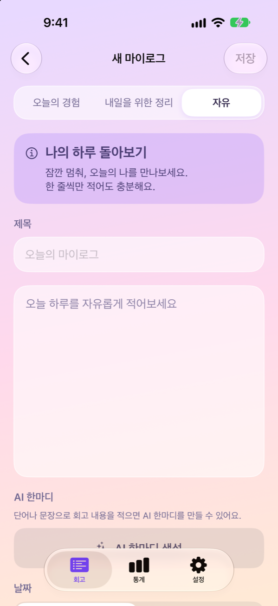<br>자유</td>
    <td align="center">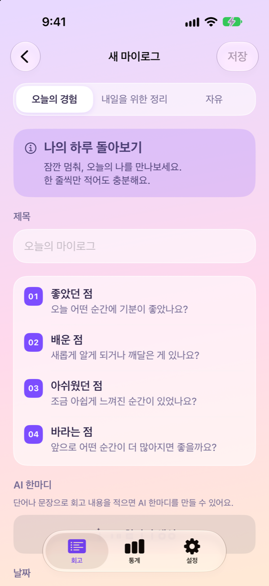<br>오늘의 경험</td>
    <td align="center">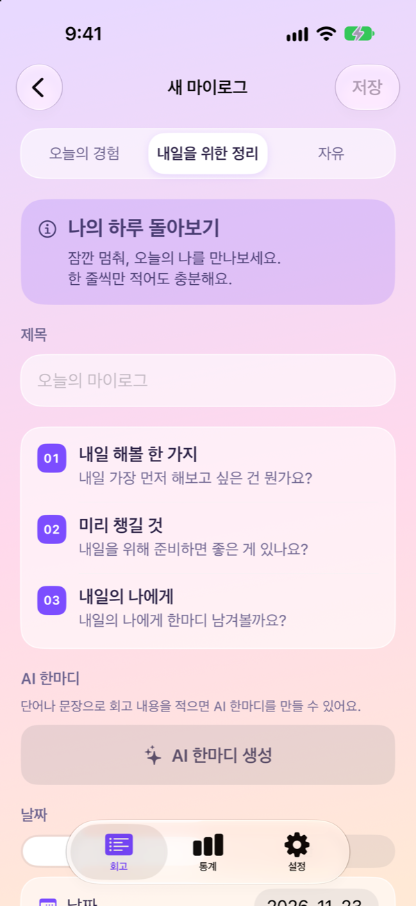<br>내일을 위한 정리</td>
  </tr>
  <tr>
    <td align="center">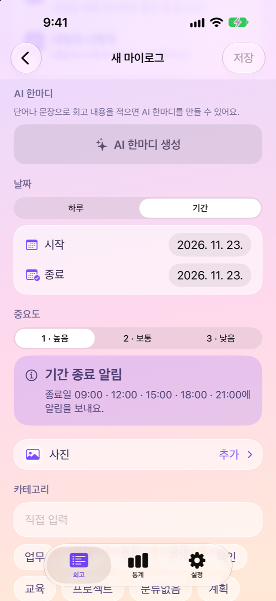<br>기간 · 중요도</td>
    <td align="center">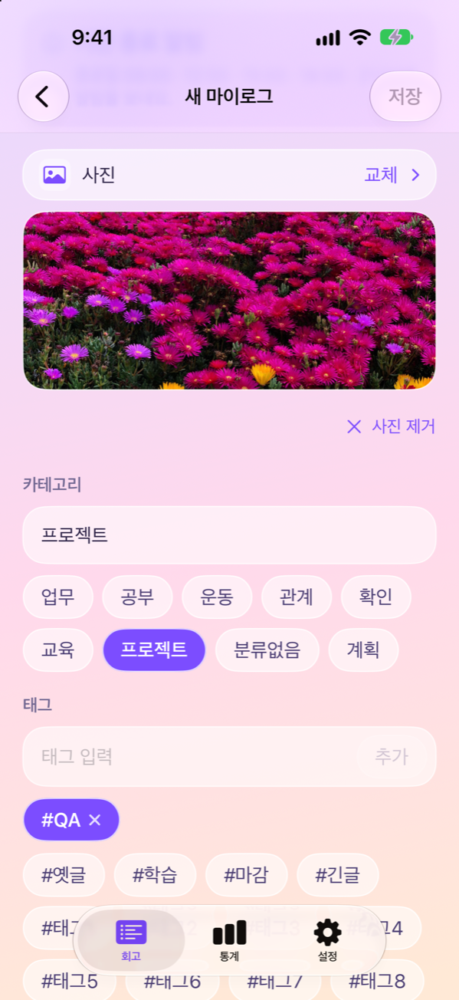<br>사진 · 카테고리 · 태그</td>
    <td align="center">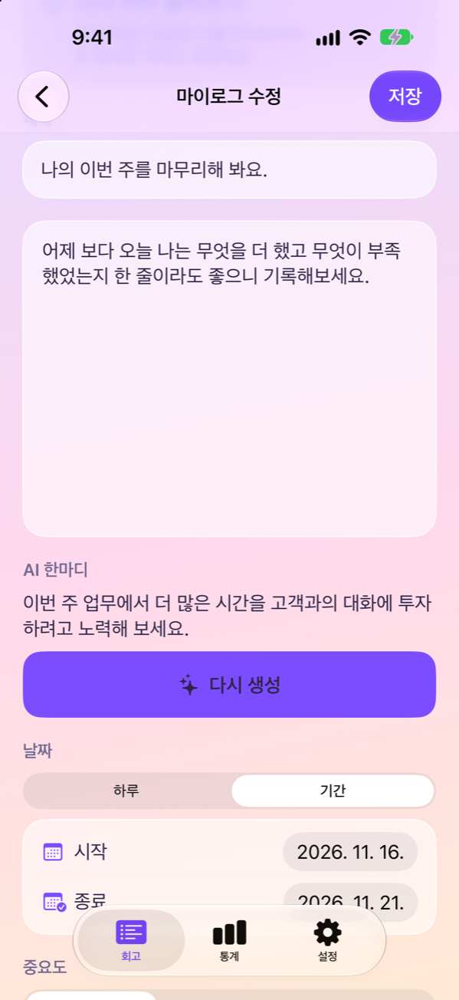<br>AI 한마디</td>
  </tr>
</table>

### 회고 상세

제목, 카테고리, 태그, 날짜, 첨부 사진, 본문이 한 카드에 보입니다. AI 한마디가 있으면 아래에 별도 카드로 나옵니다. 오른쪽 위의 `수정`(연필)과 `삭제`(휴지통) 버튼을 쓸 수 있습니다. 삭제 전에 확인 창이 나오며, 삭제한 회고는 되돌릴 수 없습니다.

<table>
  <tr>
    <td align="center">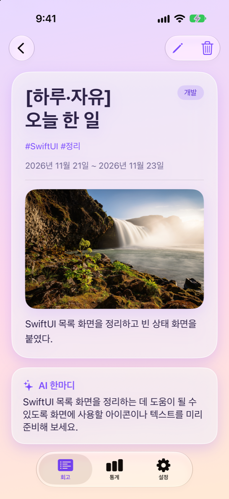<br>회고 상세 (사진 + AI 한마디)</td>
  </tr>
</table>

### 통계 탭

- 위쪽 `주간 / 월간` 스위치로 단위를 바꾸고, 좌우 화살표로 이전·다음 기간으로 이동합니다. 처음에는 이번 달을 보여 줍니다.
- 주간 통계는 **월요일부터 일요일**까지입니다.
- 통계는 회고를 **작성한 날(`createdAt`)** 기준으로 센 값입니다. 기간 회고도 작성일이 속한 주·월에 한 건으로 집계합니다.

| 영역 | 내용 |
| --- | --- |
| 회고 건수 | 선택한 기간의 전체 건수와 날짜별 막대 차트 |
| 회고 유형·사진 | 하루 회고 / 기간 회고 / 사진 첨부 건수 |
| 미등록 | 분류 없음, 태그 없음 건수. 누르면 해당 회고 목록으로 이동 |
| 기간 회고 일정 | 예정 · 진행 중 · 종료 건수, 종료일 없는 기간 회고 건수 |
| 중요도 | 1·2·3단계별 건수 |
| 자주 쓴 태그 | 태그별 회고 건수 차트 (같은 회고에 같은 태그가 반복돼도 한 번만 셈) |
| 카테고리 비율 | 카테고리별 건수와 비율 |

<table>
  <tr>
    <td align="center"><br>건수 · 일별 차트</td>
    <td align="center">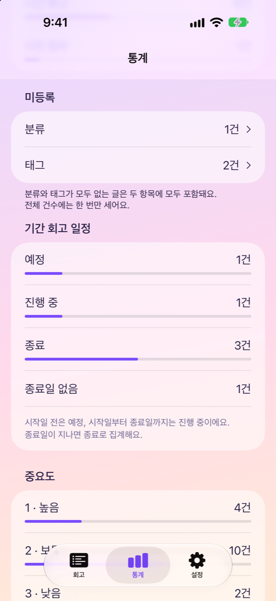<br>미등록 · 기간 일정</td>
    <td align="center">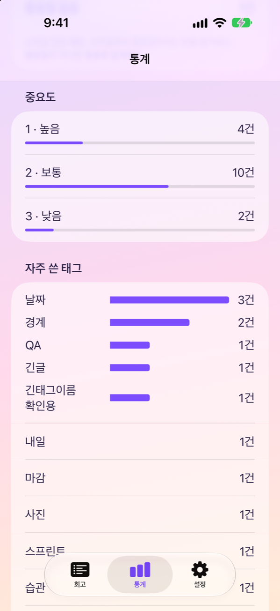<br>중요도 · 태그</td>
    <td align="center">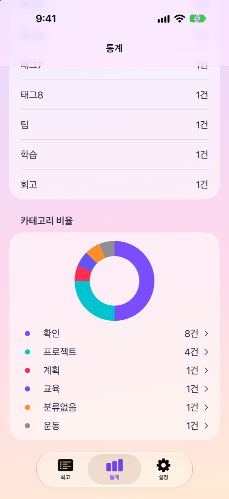<br>카테고리</td>
  </tr>
</table>

### 설정 탭

| 설정 | 선택지 | 비고 |
| --- | --- | --- |
| 화면 테마 | 시스템 · 라이트 · 다크 | 처음에는 시스템 설정을 따름. 재실행해도 유지 |
| 글자 크기 | 시스템 따르기 · 작게 · 보통 · 크게 | 앱 전체에 Dynamic Type 적용 |
| 종료일 알림 시각 | 낮 12시 한 번(기본) · 3시간 간격 | 바꾸면 예약된 알림을 새 방식으로 다시 예약 |
| 화면 밝기 | 기기 밝기 사용(기본) · 직접 조절 | 직접 조절 시작값 50%. 앱이 활성 상태일 때만 적용 |
| 개발용 (Debug 빌드만) | 확인용 샘플 넣기 · 회고 전체 삭제 | Release 빌드에는 나타나지 않음 |

<table>
  <tr>
    <td align="center"><br>설정 (라이트)</td>
    <td align="center">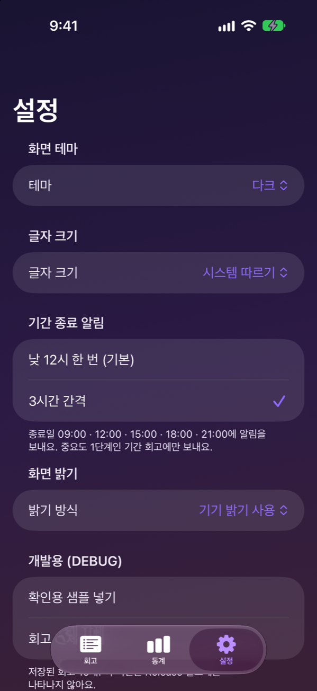<br>설정 (다크)</td>
  </tr>
</table>

## 동작 규칙 자세히 보기

### 중요도와 종료 알림

- 중요도는 `1 · 높음`, `2 · 보통`, `3 · 낮음`입니다. 값이 없는 옛 글은 2(보통)로 취급합니다.
- **알림 대상**은 `기간 회고`이면서 `중요도 1단계`이고 `종료일이 있는 글`입니다. 그 외에는 알림이 없습니다.
- 알림 시각은 설정에 따라 다릅니다.
  - 낮 12시 한 번(기본): 종료일 12:00
  - 3시간 간격: 종료일 09:00 · 12:00 · 15:00 · 18:00 · 21:00
- 이미 지나간 시각은 예약하지 않습니다.
- 알림 문구: "기간 회고가 오늘 끝나요 / ‘제목’ 회고 기간이 오늘 끝나요. 마무리 기록을 남겨 보세요."
- 알림을 누르면 앱이 열리고 해당 회고의 상세 화면으로 이동합니다.
- 회고를 수정하거나 삭제하면 기존 예약을 지우고 다시 계산합니다. 하루 회고로 바꾸거나 중요도를 낮춰도 예약이 지워집니다.
- 알림 권한은 **알림 대상 회고를 처음 저장할 때** 요청합니다. 권한이 꺼져 있어도 회고는 저장되고, 예약하지 못했다는 안내만 나옵니다.

### 카테고리와 태그 정리 규칙

- 카테고리: 앞뒤 공백을 지웁니다. 빈 값과 예전 이름 `미분류`는 모두 `분류없음`으로 묶습니다.
- 태그: 앞뒤 공백과 맨 앞의 `#`을 지웁니다. 지운 뒤 비어 있으면 태그로 인정하지 않습니다. (`#독서`, `독서`, ` 독서 `는 같은 태그입니다.)

### 사진 처리

선택한 사진은 저장하기 전에 다음과 같이 바뀝니다.

- 긴 변이 **1600px**을 넘으면 줄입니다. 작은 사진은 키우지 않습니다.
- JPEG(품질 0.8)로 저장합니다.
- 사진에 적힌 회전 정보를 반영해 세로 사진이 눕지 않게 합니다.
- 다시 인코딩하기 때문에 **위치 같은 촬영 정보(EXIF)가 남지 않습니다.**
- 투명한 이미지는 흰 배경 위에 그려 저장합니다.

### AI 한마디

- Apple Intelligence의 기기 내 모델(Foundation Models)을 사용합니다. 글과 사진이 기기 밖으로 나가지 않고, API 키도 필요 없습니다.
- 사용 조건: Apple Intelligence를 지원하는 기기에서 기능이 켜져 있고, 모델 준비가 끝났으며, 한국어 생성을 지원해야 합니다.
- 조건을 채우지 못하면 이유를 안내하고 버튼을 막습니다. 이 경우에도 회고 작성과 저장은 정상 동작합니다.
- 자음·모음이나 기호만 적으면 내용을 알 수 없어 생성하지 않습니다. 완성된 글자가 있는 내용을 적어야 합니다.
- 모델에는 형식, 제목(최대 200자), 본문(최대 1,600자)만 전달합니다.
- 모델이 아직 준비 중이면 2초 뒤 **한 번만** 다시 시도합니다. 응답 제한이나 그 밖의 오류는 자동으로 다시 시도하지 않고 안내만 합니다.
- 생성 중에 화면을 나가면 요청을 취소합니다.

### 이전 버전 데이터 호환

새 필드는 모두 옵셔널이거나 기본값이 있습니다. 이전 버전에서 저장한 글은 다음과 같이 열립니다.

| 옛 글의 상태 | 열릴 때의 처리 |
| --- | --- |
| 형식 값 없음 | 자유 형식 |
| 중요도 값 없음 | 2(보통) |
| 기간·사진 필드 없음 | 하루 회고, 사진 없음 |
| 예전 질문 이름(`Keep`, `Liked` 등) | 현재 질문과 연결 |

> 저장되는 원시값이 있는 `enum`(`ReflectionFormat`, `ReflectionImportance` 등)의 값과 질문 이름(`key`)은 바꾸지 마세요. 바꾸면 이미 저장된 글을 읽지 못하거나 답변과의 연결이 끊어집니다.

## 실행 환경

| 항목 | 값 |
| --- | --- |
| 플랫폼 | iPhone, iPad (iOS) |
| 최소 배포 버전 | iOS 27.2 (`IPHONEOS_DEPLOYMENT_TARGET`) |
| 언어 | Swift 5 (`SWIFT_VERSION`) |
| UI / 저장소 | SwiftUI / SwiftData |
| 개발 도구 | iOS 27.2 SDK를 포함한 Xcode |
| 표시 언어 | 한국어 |

> AI 한마디는 Apple Intelligence를 지원하는 기기(또는 시뮬레이터)에서 기능을 켜 두고, 모델 준비가 끝나야 사용할 수 있습니다.

## 설치 및 실행 방법

1. 저장소를 내려받습니다.

   ```bash
   git clone https://github.com/bum8844/Journal.git
   cd Journal
   ```

2. Xcode에서 프로젝트를 엽니다.

   ```bash
   open Journal.xcodeproj
   ```

3. 상단 스킴을 `Journal`로 두고, 실행할 시뮬레이터나 기기를 고릅니다.
4. 실제 기기에서 실행하려면 **Signing & Capabilities**에서 본인의 Team을 선택합니다.
5. `⌘ + R`로 실행합니다.

**처음 실행할 때**

- 중요도 1(높음)인 기간 회고를 처음 저장할 때 알림 권한 요청이 나옵니다. 허용해야 기간 종료 알림을 받을 수 있습니다.
- 사진 선택에는 시스템 사진 선택기(PhotosPicker)를 쓰기 때문에 사진 전체 접근 권한이 필요하지 않습니다.
- Debug 빌드의 **설정 탭 맨 아래**에서 "확인용 샘플 넣기"를 누르면 샘플 회고로 화면을 바로 확인할 수 있습니다.

## 의존 라이브러리

외부 패키지(Swift Package Manager, CocoaPods 등)는 사용하지 않습니다. Apple이 제공하는 기본 프레임워크만 씁니다. 따로 설치할 것은 없습니다.

| 프레임워크 | 용도 | 주로 쓰는 곳 |
| --- | --- | --- |
| SwiftUI | 화면 구성 | 앱 전체 |
| SwiftData | 회고 저장 (`@Model`, `@Query`) | `Models/`, 목록, 통계 |
| Charts | 통계 차트 | `ReflectionStatisticsCharts.swift` |
| PhotosUI | 사진 선택 (`PhotosPicker`) | `JournalPhotoPicker.swift` |
| ImageIO | 사진 크기 줄이기, JPEG 변환 | `JournalPhotoPicker.swift` |
| UserNotifications | 기간 종료 로컬 알림 | `Notifications/` |
| FoundationModels | AI 한마디 (기기 내 모델) | `AI/` |
| Observation | 알림 이동 상태 관리 | `Notifications/NotificationRouting.swift` |
| UIKit | 화면 밝기, 이미지 처리 등 일부 시스템 기능 | `DisplaySettings.swift`, `JournalPhotoPicker.swift` |
| Foundation | 날짜, 문자열 처리 | 앱 전체 |

## 폴더 구조

```text
Journal/
├── README.md
├── .gitignore
├── Design/                              # 디자인 시안 (HTML 목업)
│   ├── mylog-mockups.html
│   ├── mylog-mockups-2.html
│   └── mylog-mockup-glass.html
├── docs/                                # 팀 공유 문서, QA 기록
│   ├── images/                          # README 스크린샷
│   ├── qa-checklist.md
│   ├── ai-comment-team-handoff.md
│   ├── statistics-settings-integration.md
│   ├── model-fields-notice.md
│   ├── editor-period-photo-handoff.md
│   ├── period-photo-integration.md
│   └── qa-*.md                          # 날짜별 QA 기록
├── Journal.xcodeproj/                   # Xcode 프로젝트
└── Journal/                             # 앱 소스
    ├── JournalApp.swift                 # 앱 진입점, SwiftData 컨테이너, 테마·글자 크기·밝기 적용
    ├── ContentView.swift                # 하단 탭 (회고 · 통계 · 설정)
    ├── JournalEditorView.swift          # 회고 작성·편집 화면
    ├── JournalCategory.swift            # 카테고리 이름 규칙 ("분류없음")
    ├── JournalTag.swift                 # 태그 정리 규칙
    ├── ReflectionStatistics.swift       # 통계 계산 (순수 로직)
    ├── ReflectionStatisticsView.swift   # 통계 화면
    ├── ReflectionStatisticsCharts.swift # 통계 차트
    ├── ThemeSettingsView.swift          # 설정 화면, AppTheme
    ├── DisplaySettings.swift            # 글자 크기·밝기 설정
    ├── DebugToolsSection.swift          # Debug 빌드 전용 개발 도구
    ├── Info.plist
    ├── Assets.xcassets/                 # 앱 아이콘, 테마 색상, 시작 화면 이미지
    ├── AI/
    │   ├── ReflectionCommentGenerator.swift  # AI 한마디 생성, 오류·재시도 처리
    │   └── ReflectionCommentInput.swift      # 모델에 보낼 입력 정리
    ├── Models/
    │   ├── JournalDatabase.swift                    # SwiftData 모델 (회고 한 건)
    │   ├── JournalDatabase+ReflectionFormat.swift   # 형식·답변 타입, 회고 날짜 계산
    │   ├── JournalDatabase+Classification.swift     # 카테고리·태그 정리와 필터
    │   ├── ReflectionFormat+Display.swift           # 형식 이름과 질문 문구
    │   ├── ReflectionImportance.swift               # 중요도
    │   ├── JournalDeletion.swift                    # 삭제 규칙 (저장 실패 시 되돌림)
    │   ├── JournalDatabase+Samples.swift            # 미리보기용 샘플
    │   └── JournalDatabase+DebugSamples.swift       # Debug 빌드용 확인 샘플
    ├── Notifications/
    │   ├── PeriodReminderPlanner.swift      # 어떤 알림을 언제 보낼지 계산
    │   ├── PeriodReminderScheduler.swift    # 알림 권한 확인과 예약
    │   ├── PeriodEndReminderMode.swift      # 알림 시각 방식 (낮 12시 / 3시간 간격)
    │   └── NotificationRouting.swift        # 알림을 눌렀을 때 상세 화면으로 이동
    ├── Theme/
    │   └── JournalTheme.swift               # 색상, 배경, 유리 카드 스타일
    ├── Extensions/
    │   └── Date+Korean.swift                # 날짜 한국어 표기
    └── Views/
        ├── LaunchCoverView.swift            # 시작 커버 화면
        ├── Components/                      # 여러 화면이 함께 쓰는 UI
        │   ├── JournalChip.swift                    # 칩 버튼
        │   ├── JournalFilterBar.swift               # 카테고리·태그 필터
        │   ├── JournalClassificationPicker.swift    # 카테고리·태그 입력
        │   ├── JournalPeriodPicker.swift            # 하루/기간 선택, 날짜 검사
        │   ├── JournalImportancePicker.swift        # 중요도 선택
        │   ├── JournalPhotoPicker.swift             # 사진 선택, 크기 줄이기
        │   ├── ImportanceBadge.swift                # 중요도 배지
        │   └── JournalFormStyle.swift               # 입력칸 스타일
        ├── Editor/                          # 작성 화면 구성 요소
        │   ├── FormatTabBar.swift                   # 형식 선택 탭
        │   ├── FormatGuideBanner.swift              # 안내 배너
        │   └── QuestionCard.swift                   # 질문별 입력 카드
        ├── List/                            # 목록 화면
        │   ├── JournalListView.swift                # 목록, 검색·필터 연결
        │   ├── JournalDaySection.swift              # 날짜별 묶음 규칙
        │   └── Components/
        │       ├── JournalCardView.swift            # 회고 카드
        │       └── JournalSearchBar.swift           # 검색창
        └── Detail/
            └── JournalDetailView.swift      # 회고 상세 화면
```

## 데이터 모델

회고 한 건은 SwiftData 모델 `JournalDatabase`로 저장합니다. 변수·함수 이름은 `lowerCamelCase`, 타입 이름은 `UpperCamelCase`를 사용합니다.

| 프로퍼티 | 타입 | 의미 |
| --- | --- | --- |
| `id` | `UUID` | 고유 식별자 |
| `title` | `String` | 회고 제목 |
| `content` | `String` | 회고 본문. 질문형 글은 질문과 답변을 합쳐 저장 |
| `createdAt` | `Date` | 최초 작성일. 편집해도 유지. 목록 정렬과 통계 기준 |
| `category` | `String` | 카테고리 한 개 |
| `tags` | `[String]` | 태그 여러 개. 없으면 빈 배열 |
| `format` | `ReflectionFormat?` | 작성 형식 (`free` / `tomorrow` / `fourL`). 없으면 자유 |
| `answers` | `[ReflectionAnswer]` | 질문별 답변 (질문 이름 + 내용) |
| `isPeriod` | `Bool` | `false`면 하루 회고, `true`면 기간 회고 |
| `startDate` / `endDate` | `Date?` | 회고 날짜 또는 기간의 시작·종료일 |
| `photoData` | `Data?` | 첨부 사진 한 장. 외부 저장소(`externalStorage`)에 보관 |
| `importance` | `ReflectionImportance?` | 중요도 1~3. 값이 없으면 2(보통) |
| `aiComment` | `String?` | AI 한마디 |

`reviewDate`(회고 대상 날짜)는 저장 필드가 아니라 계산 값입니다. 시작일이 있으면 시작일, 없으면 작성일을 씁니다.

## 개발 참고

- **구조**: 화면은 SwiftUI `View`, 저장은 SwiftData `@Model`/`@Query`입니다. 알림 계획, 통계 계산, 날짜 검사처럼 규칙이 있는 부분은 화면과 저장소를 몰라도 되는 값 타입(`ReminderSubject`, `StatisticsEntry`, `JournalPeriodValue`)으로 분리해 따로 검증할 수 있게 했습니다.
- **테마 설정**: `@AppStorage("appTheme")`에 저장하고 `JournalApp` 루트에서 앱 전체에 적용합니다.
- **미리보기**: `#Preview`는 메모리에만 저장하는 컨테이너(`inMemory: true`)를 씁니다. 실제 회고 데이터에는 접근하지 않습니다.
- **Debug 도구**: `DebugToolsSection`은 `#if DEBUG` 안에 있어 Release 빌드에는 포함되지 않습니다.
- **테스트**: 현재 저장소에는 Xcode 테스트 타깃이 없습니다. 검증 기록은 `docs/qa-*.md`에 있습니다.
- **PR 전 확인**: [QA 체크리스트](docs/qa-checklist.md)를 따라 팀원이 함께 확인합니다.

## 자주 묻는 질문

**AI 한마디 버튼이 눌리지 않아요.**
기기에서 Apple Intelligence가 꺼져 있거나, 모델이 아직 준비 중이거나, 지원하지 않는 기기일 수 있습니다. 화면에 이유가 안내됩니다. 또 회고 내용에 완성된 글자가 있어야 합니다. 자음이나 기호만 있으면 생성하지 않습니다.

**종료 알림이 오지 않아요.**
다음을 확인해 보세요.
1. 회고가 `기간 회고`이고 `중요도 1단계`이며 종료일이 있는지
2. 종료일의 알림 시각이 이미 지나지 않았는지
3. iPhone 설정 앱에서 마이로그의 알림이 켜져 있는지 (켠 뒤 회고를 다시 저장하면 예약됩니다)

**저장한 글의 형식을 바꾸고 싶어요.**
저장한 글은 형식을 바꿀 수 없습니다. 새 회고를 원하는 형식으로 작성해 주세요.

**통계에서 기간 회고가 시작일이 아닌 작성일 기준으로 보여요.**
통계와 목록 정렬은 작성일(`createdAt`)을 기준으로 합니다. 기준을 시작일로 바꾸려면 팀 합의가 필요합니다.

**삭제한 회고를 되돌릴 수 있나요?**
되돌릴 수 없습니다. 삭제 전에 확인 창이 나옵니다.

## 참고 문서

`docs/` 폴더에 개발 중 정리한 문서가 있습니다.

| 문서 | 내용 |
| --- | --- |
| [qa-checklist.md](docs/qa-checklist.md) | PR 전 팀 QA 체크리스트 |
| [ai-comment-team-handoff.md](docs/ai-comment-team-handoff.md) | AI 한마디 동작 방식과 검증 기록 |
| [statistics-settings-integration.md](docs/statistics-settings-integration.md) | 통계·설정 구현과 통합 계획 |
| [model-fields-notice.md](docs/model-fields-notice.md) | 모델 필드 변경 공지 |
| [editor-period-photo-handoff.md](docs/editor-period-photo-handoff.md) | 작성 화면의 기간·사진 입력 인수인계 |
| [period-photo-integration.md](docs/period-photo-integration.md) | 기간·사진 기능 통합 |
| [qa-category-search-date-tags-2026-11-20.md](docs/qa-category-search-date-tags-2026-11-20.md) | 카테고리·검색·날짜·태그 QA 기록 |
| [qa-card-height-statistics-2026-11-20.md](docs/qa-card-height-statistics-2026-11-20.md) | 카드 높이·통계 QA 기록 |
| [ai-statistics-qa-2026-11-19.md](docs/ai-statistics-qa-2026-11-19.md) | AI·통계 QA 기록 |

디자인 시안은 `Design/` 폴더의 HTML 파일을 브라우저로 열어 볼 수 있습니다.

## 개발팀

**3조 (GitCode)**

<table>
  <tr>
    <td align="center" width="25%">
      <a href="https://github.com/bum8844"></a><br>
      <b>안창범</b><br>
      팀장<br>
      Git 관리<br><br>
      <a href="https://github.com/bum8844"></a>
    </td>
    <td align="center" width="25%">
      <a href="https://github.com/preview-bunny"></a><br>
      <b>김지혜</b><br>
      서기<br>
      목록·상세<br><br>
      <a href="https://github.com/preview-bunny"></a>
    </td>
    <td align="center" width="25%">
      <a href="https://github.com/kyooah2211156-choo"></a><br>
      <b>추규아</b><br>
      UI 디자인<br>
      분류<br><br>
      <a href="https://github.com/kyooah2211156-choo"></a>
    </td>
    <td align="center" width="25%">
      <a href="https://github.com/mandarake192-rgb"></a><br>
      <b>정연규</b><br>
      발표<br>
      통계·설정<br><br>
      <a href="https://github.com/mandarake192-rgb"></a>
    </td>
  </tr>
</table>

<p align="center">
  <a href="https://github.com/bum8844/Journal">저장소 보기</a> ·
  <a href="https://github.com/bum8844/Journal/graphs/contributors">참여자 그래프 (Contributors)</a>
</p>
